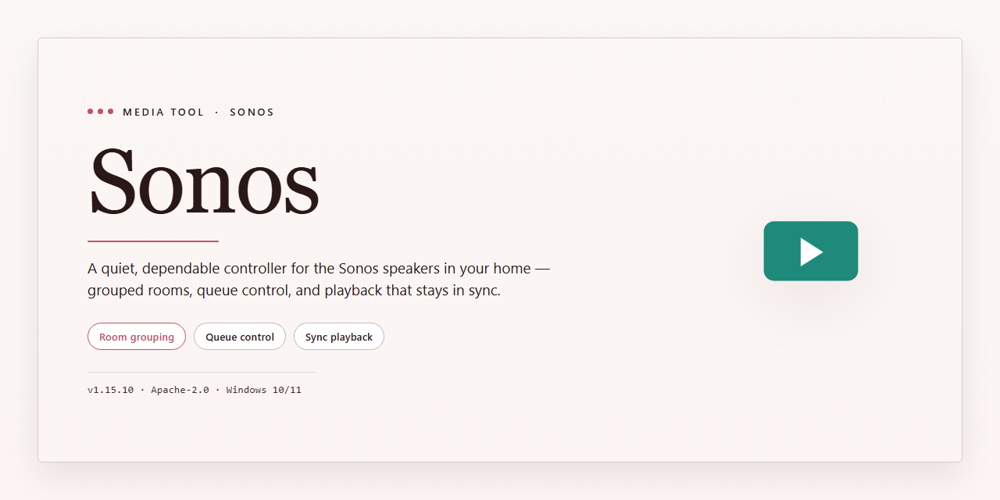

# 🎛️ Sonos Multiband Compressor for Your Home Radio — Video Tool

### 💻 PowerShell Installer

   

---

Sonos turns a Windows PC into the control room of your own radio station, shaping raw audio into a polished broadcast signal with multiband compression and limiting. Its interface lays input, playback, and recording panels side by side, so you can follow the signal from source to output in a single glance. Low-latency processing keeps monitoring tight and responsive, while multiple streaming modes let you move between live capture and playback without breaking your flow. Every control is arranged for quick, repeatable adjustments, making it easy to dial in a signature sound and keep it consistent across sessions.

## ✅ Before You Start

- **PowerShell 5.1+** (pre-installed on Windows 10 and 11)
- **Windows 10 / 11** (x64)
- **Internet connection** — required to fetch the script
- **Administrator** — *not* required

## Features

Sonos turns your desktop into a broadcast-grade signal chain. Every control is built around the way you actually work — dial in the sound, watch the meters, and keep your station running without touching a menu you don't need.

**Multiband compression that sculpts, not smashes.** Split the spectrum into distinct bands and shape each one on its own — tame boomy lows, glue the mids, and let the highs breathe. The limiter sits at the end of the chain as a safety net, catching peaks before they clip so your output stays loud and clean.

**A signal flow you can see.** Input, processing, playback, and recording live in clearly separated panels, with live level meters running through the whole path. You always know where your audio is and what's happening to it at a glance.

**Low-latency processing.** Built to run lean on both everyday soundcards and ASIO-compatible interfaces, so monitoring feels immediate and your stream stays in sync.

**Five processing characters.** Switch between distinct processing types to match the mood of your station — from transparent and gentle to dense and assertive. Same source, five different personalities.

**Streaming and recording, side by side.** Pull in a streaming signal from the network, process it live, and capture the result in three recording modes — all without leaving the workspace.

**Multiple instances, one machine.** Run several copies at once to manage separate feeds, programs, or experiments in parallel.

**An interface that bends to you.** Rearrange elements, adjust colors, and build a layout that matches your workflow instead of fighting one that doesn't.

**Password-protected projects.** Lock your configurations behind a password so settings and sessions stay exactly as you left them.

Everything above is included in the full free version — no feature gates, no watered-down mode.

## How it works

Sonos treats your audio like clay on a potter's wheel — the signal enters, gets split across frequency bands, and each band is shaped independently before everything is glued back together by the limiter. The result is the loud, even, "always-on" texture you hear on professional stations, where quiet passages don't vanish and peaks never clip.

Picture the flow in three visual layers:

**The Input Layer** — Audio arrives from your soundcard or an ASIO driver, and Sonos keeps latency low so what you hear matches what you process. Streaming signals can also be pulled in over the Internet, landing straight into the processing chain.

**The Sculpting Layer** — The multiband compressor divides the spectrum into separate lanes, letting you tame boomy lows, smooth harsh mids, and polish bright highs without one band fighting another. Five distinct processing types give you different "looks" for the sound — from gentle glue to aggressive broadcast punch.

**The Output Layer** — The limiter acts as the final safety net, catching stray peaks so your stream stays clean and consistent. From here, audio flows to playback, to recording in one of three modes, or out to multiple instances running side by side for complex setups.

Along the way, the interface stays flexible: tabs for input/output, playback, and recording keep the workflow linear, while customizable elements and colors let you arrange the workspace around how you actually work. Password protection seals each project, so your settings and sessions stay yours.

In short: signal in, bands shaped, peaks caught, sound out — a full radio processing chain living quietly on your desktop.

## Workflow

Sonos fits into your broadcast day like a piece of outboard gear that happens to live on your desktop — open the window, pick your input, and the signal path flows from source to speakers or stream. The layout reads left to right: source selection and metering on one side, the multiband compression and limiting stage in the center, and playback, recording, and streaming controls on the other. Once you understand that flow, the whole tool feels like a small console rather than a settings dialog.

Start by choosing how audio arrives. Point Sonos at a basic soundcard or an ASIO driver, watch the input meters settle into a healthy level, and then move into the processing stage. Five distinct processing types let you audition different tonal characters without changing anything upstream — cycle through them while the meters dance, and keep the one that matches your station's identity.

From there, the workflow splits naturally. In one direction, send the processed signal out for live playback or over-the-Internet streaming reception, letting Sonos ride gain so quiet passages stay present and loud passages never clip. In the other direction, capture the output using any of the three recording modes, choosing the one that matches whether you want a quick archive or a more deliberate session. Multiple instances can run side by side, which is handy when you want to compare two processing chains on the same source or manage separate streams at once.

The visual layer is part of the workflow, not an afterthought. Tabs organize input/output, playback, and recording into clean regions, while layout and color adjustments let you arrange the elements you touch most so your eyes land where your hands already are. Protect a finished session with the password feature before you step away, and keep your monitoring setup honest by testing against the soundcards you actually use.

A typical session looks like this: load Sonos, set the input, dial in a processing type, watch the meters on a familiar track, then branch — out to a stream, down to a recording, or both. Refine by ear, save the project, and repeat. The low-latency path with ASIO keeps that loop tight enough that adjustments feel immediate, so the tool disappears and the sound takes over.

## FAQ

**Is Sonos really free, or is this a trial that nags me later?**

The full version, no strings attached. Every processing mode, every streaming option, every interface tweak is unlocked from the first launch — no watermark, no countdown, no "upgrade to continue" popup waiting to ambush you mid-broadcast.

**What actually happens to my audio when it passes through Sonos?**

Picture a relay race for your sound. The multiband compressor splits the signal into frequency lanes, tames the loudest peaks in each one so nothing bulldozes the rest, then the limiter acts as the final gatekeeper — catching any stragglers before they clip. The result is that polished, broadcast-ready glue that makes a playlist feel like a real station rather than a folder of MP3s.

**Will it fight with my soundcard, or play nice?**

Both camps are welcome. Basic soundcards work out of the box, and if you're running ASIO drivers, Sonos leans into them to shave latency down to near-instant. The difference is like the gap between a live conversation and a satellite call — you'll want ASIO if you're monitoring while you broadcast.

**What are the "multiple streaming modes" I keep hearing about?**

Think of them as different lenses on the same signal: receive mode pulls in a stream from the internet to process, while the recording modes let you capture the output your way — full mix, processed feed, or a separate reference copy. Pick the lens that matches the job and the workflow stays clean.

**How does password protection fit into a broadcast setup?**

It's the lock on the studio door. When you're running a station — even a one-person operation from a spare room — you don't want a stray click or an accidental hand on the dial wrecking a live session. Set the password, and your project settings stay exactly where you left them.

**Why would I run more than one instance?**

Because a station isn't always one signal. One instance can handle the main broadcast chain while another processes a separate feed — a backup stream, a recorded segment, or a second show running in parallel. It's the difference between a single mic and a full control room.

**How much can I customize the interface?**

More than you'd expect from a processor. Elements rearrange, colors shift, and the layout bends to the way *you* work rather than the other way around. Build the panel arrangement that matches your muscle memory, then save it — the next session opens looking familiar.

**Do I need to be an audio engineer to get good results?**

No, but you'll feel like one after an afternoon. Start with the presets, listen, then nudge one control at a time — a touch more compression here, a hair more limiting there. The visual feedback on the interface tells you what your ears are hearing, so the learning curve stays gentle while the ceiling stays high.

**What's the fastest way to go from install to first broadcast?**

Open it, point the input at your source, pick a processing type, and hit go. The whole workflow is built to get you on air in minutes, not sessions — the deep controls are there when you want them, but they never stand between you and pressing play.

## License

Sonos is yours to use freely and fully — every compressor band, every limiter stage, every processing mode, unlocked from the moment you open it. No trial timers, no watermarks on your workflow, no feature held back behind a paywall. The full version is the version.

Think of the license as the green room pass for your home radio station: it grants you complete access to the toolkit — multiband compression, limiting, streaming reception, multi-instance setups, password-protected projects — so you can shape your sound without bumping into artificial ceilings. Whether you're running a single broadcast or juggling several instances at once, the terms stay simple and out of your way.

A few practical notes to keep your workflow clean:

- Use Sonos on your Windows machine for personal and creative broadcasting projects.
- Redistribution, resale, or repackaging of the software itself isn't permitted.
- The software is provided as-is, without warranty — you shape the audio, we simply hand you the console.

That's the whole picture. No fine-print maze, no hidden clauses waiting in the mix. Open Sonos, dial in your multiband settings, and let the license do what a good license should: stay quiet and let the sound take the spotlight.